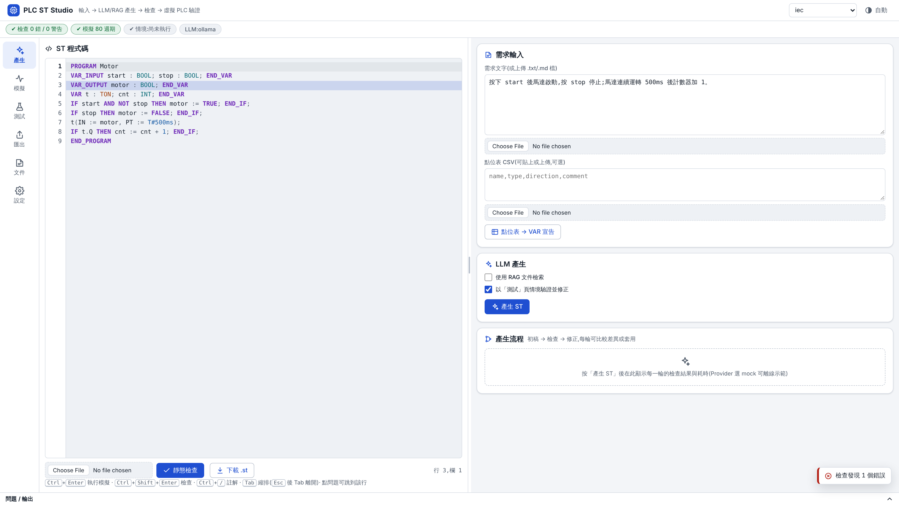
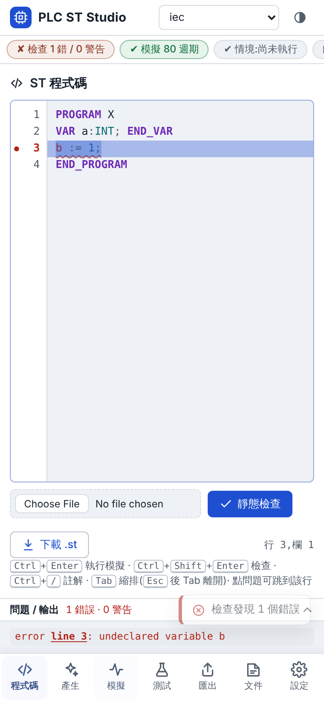
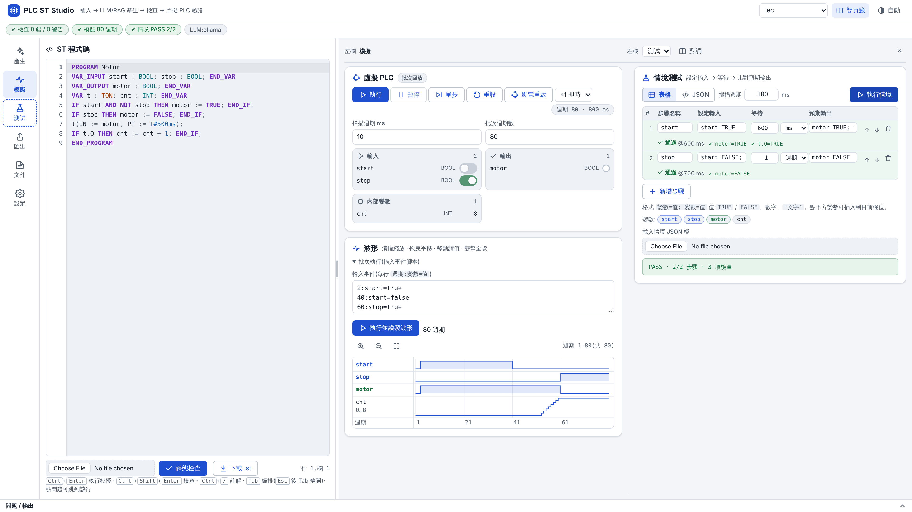

# PLC ST Auto

PLC Structured Text (IEC 61131-3 ST) 開發工具:輸入需求 → LLM(搭配 RAG)產生 ST → 虛擬 PLC 驗證 → 輸出可上傳實體 PLC 的程式碼。

## 目標功能
1. 多種輸入:文字、檔案上傳、點位表格(CSV)
2. RAG:外部文件向量庫,降低幻覺
3. LLM:Gemini / GPT / Claude / Ollama 可設定
4. 虛擬 PLC:載入 ST 後以掃描週期模擬執行
5. 多廠牌模擬 profile(Siemens / Rockwell / Mitsubishi / CODESYS / Omron …)
6. 排程開發:見 `roadmap.md`、`todo.md`

## 目前狀態
M1 完成:純標準庫 ST 解譯器(`plc_st/`)。無外部相依。

## 使用
```python
from plc_st import VirtualPLC
plc = VirtualPLC(open("examples/motor.st").read())
plc.set_input("start", True)
plc.scan(10)
print(plc.get("motor"))
```
測試:`python3 -m unittest discover -s tests -v`

## CLI (M2)
```
python -m plc_st run examples/motor.st --cycles 10 --scan-ms 100 --set stop=false --at 1:start=true --trace out.csv
python -m plc_st tags examples/points.csv   # CSV 點位表 → VAR 宣告
python -m plc_st tags examples/points_addr.csv --format tia -o tags.xlsx   # 點位表 → 各廠牌標籤表(M38)
```
點位表欄位: `name,type,direction(IN/OUT/INOUT/VAR/CONST/RETAIN),init,comment,address`。`address` 選用,填 IEC 直接位址(`%IX0.0`、`%QW2`…)時宣告為 `name AT %IX0.0 : BOOL;`(範例 `examples/points_addr.csv`)。

## 靜態檢查 (M4)
```
python -m plc_st check examples/motor.st --profile siemens-s7-1200
```

## LLM 產生 (M5)
```
export ANTHROPIC_API_KEY=...   # 或 OPENAI_API_KEY / GEMINI_API_KEY;ollama 不需金鑰
python -m plc_st generate "馬達啟停,停止優先" --provider claude --tags examples/points.csv -o out.st
```
產生後自動執行 `check`;LLM 輸出仍須經虛擬 PLC 與廠牌官方工具驗證。
沒有金鑰時可用 `--provider mock`(離線示範,初稿故意留一個錯誤,展示自動修正流程)。Web UI 產生頁會顯示每一輪的檢查結果、耗時與修正差異,點位表貼上後即時預覽(UI5)。
產生採串流(M40,`POST /api/generate/stream` 回傳 NDJSON):每一輪完成就更新時間軸與編輯器,進行中的輪次顯示「修正中」,可按「停止」中斷(保留已完成的輪次,伺服器不再呼叫 LLM)。示範慢速回應可用 `mock` + model `demo-slow`。

## RAG (M6)
```
python -m plc_st index examples/docs -o docs.idx.json      # 文件/資料夾 → 索引
python -m plc_st search docs.idx.json "TON 計時器"
python -m plc_st generate "..." --index docs.idx.json --top-k 4
```

## 情境測試 (M8)
```
python -m plc_st test examples/motor.st examples/motor_scenario.json
```
JSON:`steps` 每步 `set` 輸入 → 掃描 `cycles`/`ms` → 比對 `expect`(支援 `t.Q` 這類 FB 成員);不符 exit 1。

## 產生時情境驗證 (M9)
```
python -m plc_st generate @req.txt --scenario examples/motor_scenario.json --provider claude -o out.st
```
靜態檢查通過後在虛擬 PLC 跑情境,不符的步驟會回饋 LLM 修正(受 `--max-rounds` 限制)。

## LLM 評測 (M30)
```
python -m plc_st eval --provider claude --model claude-haiku-5-5 --model claude-sonnet-5-5 --repeat 3
```
14 個案例(工控原語、點位表、RAG、方言、TC6 XSD、多廠牌匯出、情境修正、防溢位、安全假設、Web API),
判定條件固定寫在 `plc_st/llm_eval.py`。輸出 `eval_out/<時間>/report.md`(通過率、一次正確率、修正輪數、
耗時、token;加 `--price 模型=輸入,輸出` 可估算費用)與每次產生的 `.st`。`--cases TC-01,TC-04` 可只跑部分案例。

## 注意:「無警告」不等於相容
`check` 的廠牌方言檢查(`plc_st/dialect.py`)是保守的啟發式規則,只涵蓋少數已知差異。
未出現警告不能視為通過該廠牌 IDE/PLC 的編譯或相容性驗證,上傳實機前請以廠牌官方工具再驗證。

## Web UI
`python -m plc_st serve --port 8765` 後開啟 http://127.0.0.1:8765 (僅本機)。

| 桌機 1920×1080 | 手機 390×844(底部導覽) |
|---|---|
|  |  |

版面(UI7):整頁不捲動;程式碼欄與頁籤欄中間的分欄把手可拖曳(或聚焦後用 ←/→、Shift 加大步距、Home/End,雙擊或 Enter 還原 50%)。

雙頁籤(UI8,視窗寬度 ≥1600px):按頂列「雙頁籤」後右側同時顯示兩個頁籤(例:左欄模擬看波形、右欄測試跑情境)。右欄用上方下拉選單、`Shift`+點頁籤或 `Alt+Shift+1~6` 指定,可「對調」;設定會記住,視窗變窄時自動回到單頁籤。


寬度 ≤820px(手機/平板直向)改為底部導覽列,「程式碼」鍵與各頁籤一次顯示一個;點問題清單會自動切到編輯器並定位。
介面會記住 provider/model/base URL、修正輪數、廠牌 profile、模擬參數、最後頁籤、分欄寬度與程式碼草稿(瀏覽器 localStorage,前綴 `plcst.`);**API Key 一律不儲存**。設定頁可關閉「記住程式碼草稿」或「清除記憶」。
無障礙:第一個 Tab 為「跳到程式碼編輯器」、問題抽屜可用鍵盤開關、所有互動元素有可讀名稱(E2E 稽核)。

UI 功能測試:`PYTHONPATH=. CHROMIUM_PATH=<chromium> python tests/ui_smoke.py`(需 playwright)。報告見 `docs/test_report_M11.md`。

程式碼編輯器(UI3):行號、ST 語法色彩、輸入後自動檢查並在行號/程式行標記錯誤與警告、點擊問題清單或行號跳到該行、游標行/欄顯示。
模擬儀表板(UI4):執行/暫停/單步/重設與速度(×0.2/×1/×10)、I/O 面板(BOOL 輸入開關、輸出燈號、數值即時顯示;暫停時切換的輸入於下一掃描生效)、波形每變數一軌(STRING 以文字帶顯示、長名稱截斷)、滾輪縮放/拖曳平移/游標讀值/雙擊全覽;批次執行(事件腳本)後游標移動時 I/O 面板回放該週期值。快捷鍵 `Alt+R` 執行/暫停、`Alt+S` 單步。API:`/api/sim/start|step|stop`。執行期錯誤訊息帶行號並標記於編輯器。

情境測試與匯出(UI6):情境可用表格編輯(步驟名稱/設定輸入 `變數=值; …`/等待 ms 或週期/預期輸出),與 JSON 雙向切換,變數晶片一鍵插入;執行後逐步顯示 ✔/✘ 與實際值。匯出頁以 6 張廠牌卡片顯示可否匯出、不支援原因、方言警告(點擊跳行)與預覽。API:`/api/test`(回傳 `steps`)、`/api/export/status`。
快捷鍵:`Ctrl+Enter` 執行模擬、`Ctrl+Shift+Enter` 靜態檢查、`Ctrl+/` 註解切換、`Tab`/`Shift+Tab` 縮排(先按 `Esc` 再按 Tab 可離開編輯器)、`THEN`/`DO` 等之後 Enter 自動縮排。
E2E:`python -m plc_st serve --port 8765` 後 `NODE_PATH=$(npm root -g) node tests/ui_e2e.js [截圖資料夾]`(`UI3_SHOTS=`/`UI4_SHOTS=`/`UI5_SHOTS=`/`UI6_SHOTS=`/`UI7_SHOTS=` 指定各階段截圖資料夾)。

## 陣列 (M17)
支援一維 `ARRAY[lo..hi] OF T`(可帶初始值 `:= [1,2,3]`),以 `a[i]` 讀寫;越界於靜態檢查(常數索引)與執行期皆報錯。
`--set buf[2]=5`、情境與 trace 以 `buf[0]`、`buf[1]`… 欄位呈現。尚不支援多維陣列、STRUCT;PLCopen 匯出為 `<array>`,其他廠牌匯出保留原 ST 宣告文字。

## 修飾詞與直接位址(M34)
支援 `VAR CONSTANT`、`VAR RETAIN`(含 `PERSISTENT`)、`VAR_TEMP` 與 `name AT %IX0.0 : BOOL`(%I/%Q/%M),範例 `examples/qualifiers_m34.st`。
- 虛擬 PLC:寫入常數會報錯;`VAR_TEMP` 每個掃描週期重新初始化;`%I` 變數是輸入、`%Q` 是輸出;Web UI「斷電重啟」或情境步驟 `"restart": "warm"|"cold"` 可驗證 RETAIN 行為。
- 檢查:寫入常數、型別與位址大小不符為 error;位址**部分**重疊為 warning(Siemens 以 byte 定址,IEC/CODESYS 以大小定址);完全包含的別名(位元在字內、REAL 與 DWORD 同位址)不警告。
- 共用記憶體(M37,範例 `examples/shared_memory.st`):重疊的直接位址在虛擬 PLC 中共用位元組,寫入 `%MW0` 時 `%MX0.0` 立即同步,強制 `%IB0` 即可一次設定 8 個輸入位元。位元組順序依 profile:IEC/CODESYS little-endian(`%MX0.0` = `%MW0` bit 0),Siemens big-endian(`%M0.0` = `%MW0` bit 8)。模擬面板以 ⇄ 標記共用的變數。
- 匯出:PLCopen 帶 `constant`/`retain`/`address`;Siemens SCL 把位址變數移到檔頭的 PLC 變數表(需在 TIA 建立)並在本體加引號;L5X 以 `Constant="true"` + 初值、位址寫入 Description;GX Works3 / Sysmac 在表格列出類別與 IEC 位址,裝置需人工指定。細節與限制見 `docs/test_report_M34.md`。

## 匯出
`python -m plc_st export examples/motor.st --format plcopen|scl|l5x|gxworks|sysmac|st -o out`(Web UI 亦有「匯出」按鈕)。PLCopen XML 可匯入 CODESYS 等;scl=Siemens TIA、l5x=Rockwell Studio 5000、gxworks=Mitsubishi GX Works3(標籤表+ST)、sysmac=Omron Sysmac Studio(變數表+ST);匯出後請在目標 IDE 編譯確認。

自訂 `FUNCTION` / `FUNCTION_BLOCK`(M33,範例 `examples/userpou_export.st`):PLCopen XML 每個 POU 輸出一個 `<pou>`(`function` 帶 `returnType`、`functionBlock`、`program`,通過 TC6 XSD);Siemens SCL 輸出 `FUNCTION "F" : T`(FC)/`FUNCTION_BLOCK`/`ORGANIZATION_BLOCK`,函式呼叫自動改為 `"F"(x := a, …)` 具名引數,FC 區域變數改 `VAR_TEMP` 並在本體開頭補初值。Rockwell L5X(M35,範例 `examples/aoi_l5x.st`):每個 `FUNCTION_BLOCK` 轉成 `<AddOnInstructionDefinition>`(VAR_INPUT/OUTPUT → Input/Output 參數、VAR_IN_OUT → 必要 InOut 參數、其餘 → LocalTags),呼叫 `inst(a := x, q => y);` 自動改寫為 `inst.a := x; FB(inst, <InOut…>); y := inst.q;`;L5X 仍不支援 `FUNCTION`(Logix 無運算式內可呼叫的使用者函式),GX Works3、Sysmac 尚未支援,匯出卡片會說明原因。

點位表 → 各廠牌標籤表(M38):`python -m plc_st tags points.csv --format tia|logix|gxworks|sysmac|codesys [-o 檔案]`,Web UI「需求輸入」卡片的「匯出標籤表」下拉選單亦可下載。
- `tia`:TIA Portal PLC 變數表 `.xlsx`(PLC tags → Import),`PLC Tags` + `User Constants` 工作表;沒有位址的點位自動配置(IN→%I、OUT→%Q、其餘→%M,RETAIN 先配置從 MB0 起),FB/陣列/LREAL 等非基本型別略過並提醒改放 DB
- `logix`:Studio 5000 標籤 CSV(`TAG` 列、RADIX/Constant 屬性、陣列改 0 起算、TON→TIMER、WORD→INT 等替代);標籤 CSV 不含初值,需要初值請用 L5X
- `gxworks` / `sysmac`:GX Works3 全域標籤 / Sysmac 全域變數(Tab 分隔可貼上);IEC 位址寫入註解,裝置/I/O Map 需人工指定
- `codesys`:CODESYS / TwinCAT GVL(`VAR_GLOBAL` / `CONSTANT` / `RETAIN`,保留 `AT` 位址)
- 每個格式都會回傳提醒清單(CLI 印在 stderr、UI 列在按鈕下方);位址依廠牌換算(M39):`--addressing iec|s7` 指定點位表的定址(預設 iec,`%QW2` = 第 2 個 word),TIA 輸出位元組定址(→ `%QW4`)、CODESYS GVL 輸出 word 編號;Studio 5000 可加 `--logix-slots I=1,Q=2` 把 BOOL 位元位址建成 ALIAS `Local:1:I.Data.n`。UI 的「位址定址」預設依廠牌 Profile。細節 `docs/test_report_M38.md`、`docs/test_report_M39.md`

陣列參數與整體賦值(M36,範例 `examples/array_inout.st`):`VAR_IN_OUT` / `VAR_INPUT` 可宣告為陣列並傳入整個陣列變數(元素型別與每維長度須相同,下界可不同;VAR_IN_OUT 呼叫後寫回),`b := a;` 可整體複製同形狀陣列;L5X 匯出自動改寫為 `COP(a[0], b[0], n);`。靜態檢查也會指出整數初值超出型別範圍(例 `SINT := 300`)。

ARRAY OF STRUCT 的 STRUCT 含陣列欄位(M41,範例 `examples/recipe_slots.st`):`slots[i].setp[j]` 讀寫(含多維外層/內層、巢狀 STRUCT)、元素初值 `[(setp := [10, 20, 30]), ...]`、元素與單一 STRUCT 互相整體複製、元素的陣列欄位可整體讀寫 `b := slots[i].setp;` 或傳入 `VAR_IN_OUT`(呼叫後寫回該元素)。情境/波形/強制輸入的名稱為 `slots[2].setp[1]`。
PLCopen 可加 `--validate` 以官方 TC6 v2.01 XSD(`plc_st/schemas/`)驗證結構,失敗時 exit 1(需 `pip install lxml`)。
